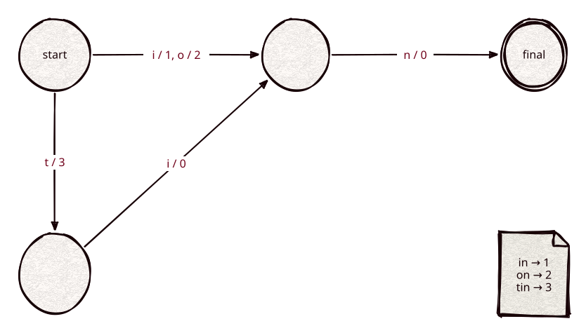

# fst

Part of [Kronuz C++ Libraries](https://github.com/Kronuz/cpp-libraries), a collection of small, reusable C++ libraries.

[](https://github.com/Kronuz/fst/actions/workflows/ci.yml)
[](LICENSE)


Minimal acyclic finite state transducers for C++20: an ordered map from byte strings
to `uint64` values that shares common prefixes and suffixes, so a vocabulary takes a
few bytes per key. Header-only, no dependencies. Built from sorted keys, read in
place from bytes (a string, a memory-mapped file).



## ✨ Highlights

One header, `fst.hh`:

- `fst::builder` takes keys in strictly increasing byte order with a value each and
  produces the FST bytes. Minimization is incremental (Daciuk et al., 2000): equal
  suffixes are shared as they are frozen, and values are pushed toward the root, so a
  key's value is the sum of the outputs on its path.
- `fst::map` reads those bytes without copying or parsing them up front:
  - `get(key)` and `contains(key)`
  - `floor(key)`: the largest key `<=` a key, with that key; `floor_value(key)`: just
    its value, in one allocation-free pass, the lookup a block-tree term dictionary
    uses to find a key's block
  - `range(lo, hi, f)`: keys in `[lo, hi)` in ascending order
  - `intersect(automaton, f)`: keys a deterministic automaton accepts, pruning every
    branch the automaton rejects (prefix, wildcard, and Levenshtein matching)

## 📦 Installation

Requires a C++20 compiler; CMake 3.14 or newer for the CMake route. CI builds it on
Linux (x86_64, arm64), macOS (arm64, x86_64), and FreeBSD, plus ASan, UBSan, and TSan
builds.

```cmake
include(FetchContent)
FetchContent_Declare(fst
  GIT_REPOSITORY https://github.com/Kronuz/fst.git
  GIT_TAG        main)
FetchContent_MakeAvailable(fst)

target_link_libraries(my_app PRIVATE fst::fst)
```

## 🚀 Quick start

```cpp
#include "fst.hh"

fst::builder b;
b.insert("cat", 7);
b.insert("cats", 8);
b.insert("dog", 3);
std::string bytes = b.finish();

fst::map m(bytes);
m.get("cats");                  // 8
m.floor("cow");                 // {"cats", 8}
m.range("c", "d", [](std::string_view k, std::uint64_t v) { return true; });
m.intersect(fst::prefix_automaton{"ca"}, [](std::string_view k, std::uint64_t v) { return true; });
```

An automaton is any type with `start()`, `accept(state, byte)`, `is_match(state)`,
and `can_match(state)`.

## ⚡ Performance

`bench/bench.cc` compares the FST with an open-addressing hash map (linear probing,
keys in one arena) and front coding in blocks of 16; values are key ordinals and
lookups use shuffled present keys.

`/usr/share/dict/words` (235,976 keys, 9.57 bytes each), Apple M4 Pro, Apple clang 17
with `-O3 -DNDEBUG`, measured under `quiet strict` at `c57e01f` (two runs agree within
1% on lookups):

| Structure | Bytes per key | Build (Mkeys/s) | Lookup p50 |
|---|---:|---:|---:|
| fst | 6.20 | 8.6 | 151 ns |
| Hash map | 62.89 | 33.7 | 24 ns |
| Front-coded array | 5.94 | 40 | 262 ns |
| fst over every 32nd key, `floor_value` | 0.36 (84 KB total) | | 111 ns |

```sh
cmake -S . -B build -DCMAKE_BUILD_TYPE=Release && cmake --build build --target fst_bench
build/fst_bench /usr/share/dict/words
```

The FST is a tenth of the hash map's size and looks up 1.7× faster than the
front-coded array. The hash map builds and looks up faster and holds no order, so it
cannot answer prefix, range, or fuzzy queries. As the index over term blocks (an FST
over every 32nd key), `floor_value` finds a key's block in 111 ns from an 84 KB index.

## 🧩 Format

Nodes are written children first; transitions store the distance down to their
target. A node with one transition (a "chain", most of a vocabulary's suffixes) is a
header, a label, an optional output varint, and a delta varint. Other nodes store
their labels as one ascending byte array, searched 16 at a time with SSE2, followed
by fixed-width output and target columns. A 16-byte trailer holds the root address
and the key count, and also lets readers load whole words past any field.
See [ARCHITECTURE.md](ARCHITECTURE.md).

## 🛠️ Building and testing

```sh
cmake -S . -B build && cmake --build build && ctest --test-dir build
build/fst_bench KEYS_FILE
build/fst_cmp_bench KEYS_FILE   # build and for_each against the reference test/fst_old.hh
```

The tests compare `get`, `floor`, `range`, and prefix intersection with `std::map`
on random key sets over 2-, 8-, and 256-letter alphabets (including the empty key
and zero outputs) and on the system dictionary. `test/diff.cc` checks that the builder
emits the same bytes as the reference implementation in `test/fst_old.hh`, and that
`range` and `for_each` visit the same keys and values. `test/collide.cc` gives every
node the same hash, so the builder's node verification decides each registry hit, and
checks the bytes against the reference over every small key set and random larger ones.

## 🎯 When to use it

- ✅ Term dictionaries and vocabularies: large, static, sorted key sets with lookups, prefix, range, and fuzzy queries.
- ❌ Keys that change: there is no insert or delete; rebuild instead.

### Limits

- Keys must arrive sorted; there is no update or delete. Rebuild to change it.
- Values are unsigned and additive.
- Little-endian hosts only.

## 📚 Documentation

- [ARCHITECTURE.md](ARCHITECTURE.md): the design and the format.
- [CHANGELOG.md](CHANGELOG.md): changes by date.
- [AGENTS.md](AGENTS.md): repository map and invariants.

## 🤝 Contributing

Issues and pull requests are welcome. Read [AGENTS.md](AGENTS.md) first. CI must
pass on every platform.

## 📄 License

MIT, Copyright (c) 2026 Germán Méndez Bravo. See [LICENSE](LICENSE).
